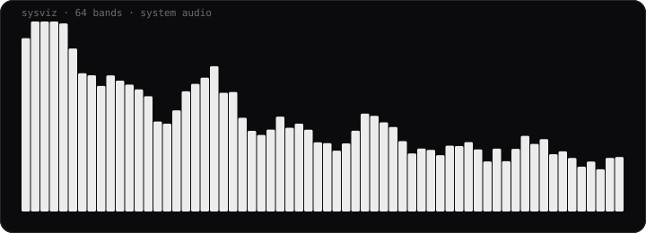

<div align="center">

# sysviz

**A macOS cava alternative: a terminal audio visualizer for whatever your Mac is playing.**

Monochrome bars, 64 logarithmic bands, zero drivers, zero config.

[](LICENSE)




</div>

---

## Why

[cava](https://github.com/karlstav/cava) is the classic terminal audio visualizer and has a lot of options. On macOS 14.2+ it can read system output directly, but only in builds with Core Audio tap support. Otherwise it needs a loopback device such as BlackHole.

sysviz is a smaller tool built around the same tap from the start. There is no loopback to install, no config file to write, and one fixed look: white bars on your terminal background. If you want that and nothing else, it's the shorter path. If you want themes and fine control, cava is the better tool.

## Features

- **System audio, directly.** Captures the default output via `AudioHardwareCreateProcessTap`. The tap is private and disappears when sysviz quits.
- **64 log-spaced bands** from 40 Hz to 16 kHz, computed with a windowed DFT on the needed frequencies only.
- **Adaptive scaling.** Each band follows its own recent peak, so quiet passages still move.
- **Smooth motion.** Fast attack, slow decay, 30 FPS.
- **Plain white bars** that fill the whole terminal window and follow its size changes.
- **Lightweight.** No FFT library and no dependencies at all.

## Requirements

- macOS **14.2 or later** (the Core Audio process tap API)
- Swift 5.9+ toolchain (Xcode 15+ or the Command Line Tools)

## Install

### Homebrew

```sh
brew tap orioshavfx/tap
brew install sysviz
```

### From source

```sh
git clone https://github.com/orioshavfx/sysviz.git
cd sysviz
sh install.sh          # builds and copies sysviz to ~/.local/bin
```

Make sure `~/.local/bin` is in your `PATH`. To remove the source build: `sh install.sh --uninstall`.

## Usage

```sh
sysviz
```

Play anything. The bars react to the whole system mix.

| Key | Action |
| --- | --- |
| `q` | quit |
| `Ctrl+C` | quit |

On first launch macOS asks for permission to capture system audio. Allow it for the terminal app you run sysviz from, then start it again.

## Build and run without installing

```sh
sh run.sh
```

## How it works

1. `SystemAudioTap` creates a private process tap that covers the global system output and wraps it in a private aggregate device.
2. An IO proxy block receives float32 buffers and downmixes them to mono into a ring buffer.
3. Every frame, `Analyzer` takes the last 2048 samples, applies a Hann window, and evaluates 64 log-spaced frequencies with a direct DFT.
4. Levels are mapped from a fixed dB range (-75 to -18 dB) and smoothed before they're drawn.

Source: [`Sources/sysviz`](Sources/sysviz): `main.swift` (analyzer, rendering, input) and `AudioTap.swift` (Core Audio capture).

## Limitations

- Developed and built on Apple Silicon. Intel Macs are not verified.
- sysviz visualizes the mixed output. It can't separate single apps.
- Requires macOS 14.2 or newer. Older systems don't have the process tap API.

## License

[MIT](LICENSE) © 2026 orioshavfx
